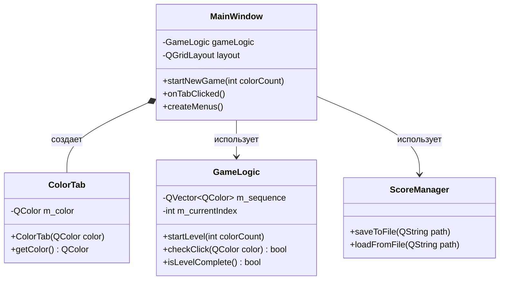
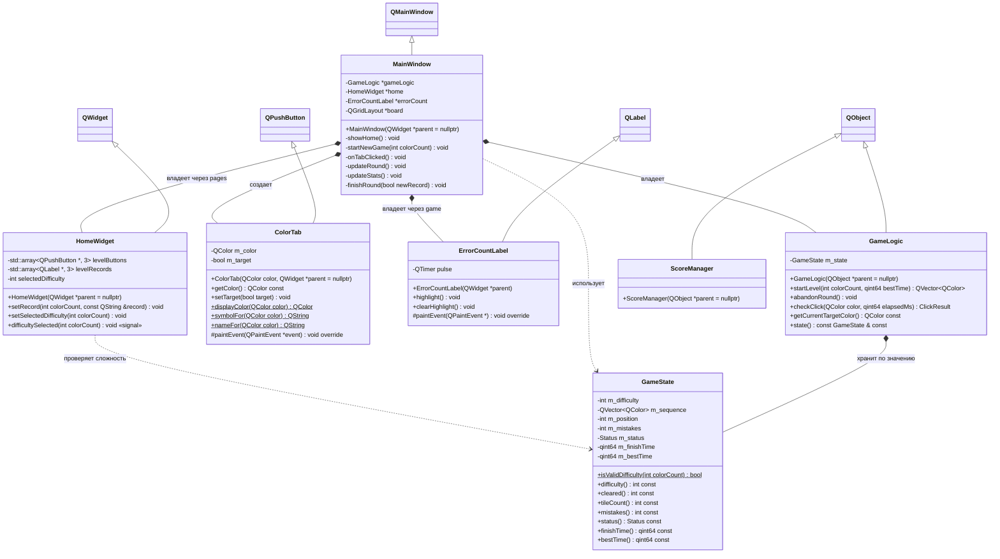

# spirt-game
Spirt Game - игра, в которой нужно решить головоломку, нажав на цветные кнопки в правильной последовательности.
Участники проекта:
Стариков А.
Пйодь А.
и
Романюк Д.
Ткаченко М.

Отчёт по 1 неделе:
1. Тема выбрана
2. Определены 3 функциональных действия: выбор сложности, нажатие на кнопку и получение обратной связи
3. Задачи распределены понедельно, первая неделя - Романюк Д., вторая - Ткаченко М., третья - Стариков А., последняя - Пьйодь А.
4. Создан и настроен git
5. Создана схема классов (в первом приближении)
## Схема классов проекта

6. Окно запускается и работает

Отчёт по 2 неделе:

1. Задачи распределены понедельно, первая неделя - Романюк Д., вторая - Ткаченко М., третья - Стариков А., последняя - Пьйодь А.
2. Реализовано главное меню, плавная заставка, таймер прохождения
3. Теперь порядок нужных цветов разный
4. Полностью переработан графический дизайн spirt-game
5. Добавлены визуальные подсказки, добавлены фигуры на каждый из цветов для пользователей с нарушением цветового зрения
6. Созданы собственные виджеты HomeWidget и ErrorCountLabel
7. Применен стандартный контейнер std::array
8. Переработан ColorTab
9. Разработана отдельная модель данных GameState, выполнено разделение интерфейса, игровых данных и игровой логики

## Схема классов проекта

